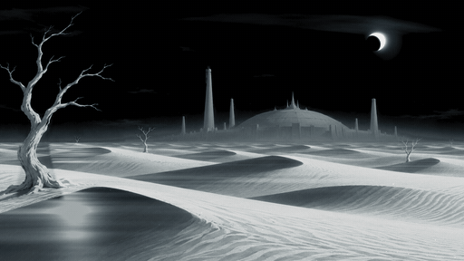
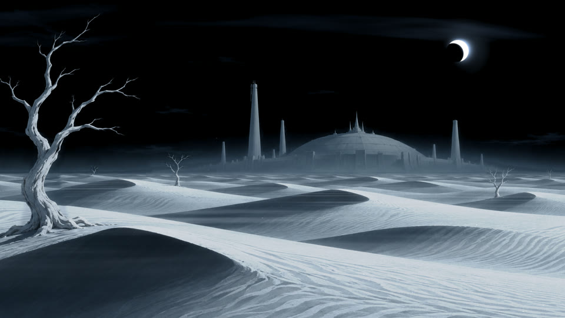
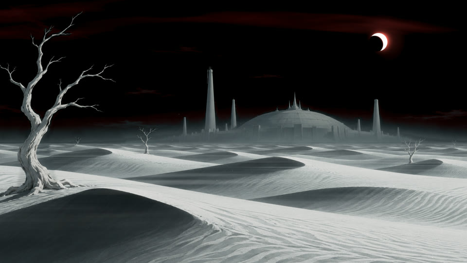

# Hollow Desert

**An animated dark-fantasy wallpaper for [Lively Wallpaper](https://livelywallpaper.net/)**

An endless white desert under a starless, eternal night.

## Overview

Hollow Desert turns a painted night scene into a living desktop. A glowing crescent moon hangs over sweeping white dunes, pale dead trees and a vast domed citadel half-lost in the haze. Sand skims across the ground and streams off the crests, clouds drift across the moon, the trees sway, and every so often the sky tears open, a distant light flares behind the citadel or a gust sweeps the dunes.

It ships as a single self-contained HTML file: no network requests, no external libraries, nothing to install beyond Lively itself.

## Features

- **Three scenes**: a lone tree before the citadel, the citadel beyond a tree, or an empty sea of dunes.
- **Three colour grades**: Bone (as painted), Azure (colder blue) and Crimson (blood-red sky and moon halo).
- **Living layers**: parallax depth, blowing sand and crest spindrift, drifting clouds and haze, swaying branches and rising motes.
- **Rare events** every 30 to 90 seconds: a rift opening in the sky, a distant flash behind the citadel and a gust front crossing the dunes.
- **Interactive**: the cursor lifts and swirls the sand, and a click sends a ring of dust rolling across the ground.
- **Music reactive**: bass drives gusts of sand and pulses the moon's halo, treble makes the sand shimmer.
- **Considerate of your machine**: frame-rate limit (60 fps by default), automatic resolution scaling on slower GPUs, and a full stop whenever Lively pauses the wallpaper.

## Scenes

| Lone Sentinel | Citadel Watch | Endless Night |
|:---:|:---:|:---:|
|  |  |  |

## Palettes

| Bone | Azure | Crimson |
|:---:|:---:|:---:|
|  |  |  |

## Installation

1. Install [Lively Wallpaper](https://livelywallpaper.net/) (version 2.2 or newer).
2. Download `hollow-desert.zip` from the [latest release](https://github.com/Emircyn/hollow-desert/releases/latest).
3. Drag the zip onto the Lively window, then select **Hollow Desert** in your library.

You can also clone this repository and drag the `hollow-desert` folder onto Lively.

## Settings

Open **Customise** on the wallpaper in Lively to change these.

| Setting | Range | Default | What it does |
|---|---|---|---|
| Scene | 3 options | Lone Sentinel | Which view of the desert is shown. |
| Palette | 3 options | Bone | The colour grade. |
| Moon size | 0–100 | 50 | Size of the crescent moon. |
| Moon glow | 10–100 | 50 | Strength of the moon's halo and the light on nearby clouds. |
| Sand brightness | 20–100 | 50 | Brightness of the lit sand. Lower it to reduce OLED wear. |
| Blowing sand | 0–100 | 50 | How much sand skims the dunes and streams off the crests. |
| Motes | 0–150 | 40 | Number of pale motes rising through the air. |
| Wind | 5–100 | 40 | Speed of sand and clouds, and how much the trees sway. |
| Parallax depth | 0–100 | 50 | How far the scene shifts with the cursor. A slow idle drift always continues. |
| Cursor strength | 0–100 | 60 | How much sand the cursor lifts. |
| Music reactivity | 0–100 | 60 | How strongly the scene responds to audio. |
| Black level | 0–100 | 50 | How aggressively dim tones are crushed to true black. |
| FPS limit | 30 / 60 / 120 / display | 60 | Frame-rate cap. |
| Render quality | 50–100 % | 100 | Rendering resolution. Changing it turns off automatic scaling. |
| Show diagnostics | on / off | off | Frame rate, audio and error overlay for troubleshooting. |

## OLED displays

Hollow Desert was tuned on a 1440p 240 Hz QD-OLED monitor:

- The sky and deep shadows are crushed to true black, so those pixels stay fully off.
- Nothing is perfectly still: the whole scene drifts slowly, the moon wanders on a long path and its glow breathes.
- Every live edge is softened, avoiding the colour fringing that hard bright lines cause on QD-OLED panels.

That said, white sand is bright by nature. Depending on the scene, 38–54% of pixels are pure black, and much of the sand stays lit while the wallpaper runs. If burn-in is a concern:

- Lower **Sand brightness**.
- Choose **Endless Night**, which has the most black sky.
- Keep your monitor's own OLED care features (pixel shift, static-area dimming) enabled.

## Technical notes

- Rendered with WebGL 1. The painted scene carries a depth map for parallax; everything else (moon, clouds, sand, motes, events) is drawn live in shaders.
- Uses Lively's `--audio` and `--pause-event` features: audio for music reactivity, and the pause event to stop rendering completely when a fullscreen app is running.
- Recovers from GPU context loss, and falls back to a static image when WebGL is unavailable.

## Credits

The painted scenes were generated with an AI image model and then animated by hand. All code is original.

## License

Released under the [MIT License](LICENSE).