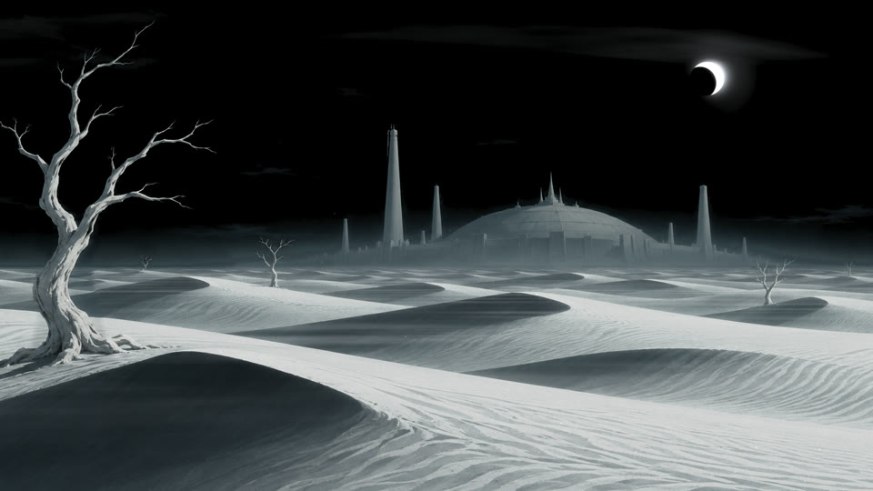
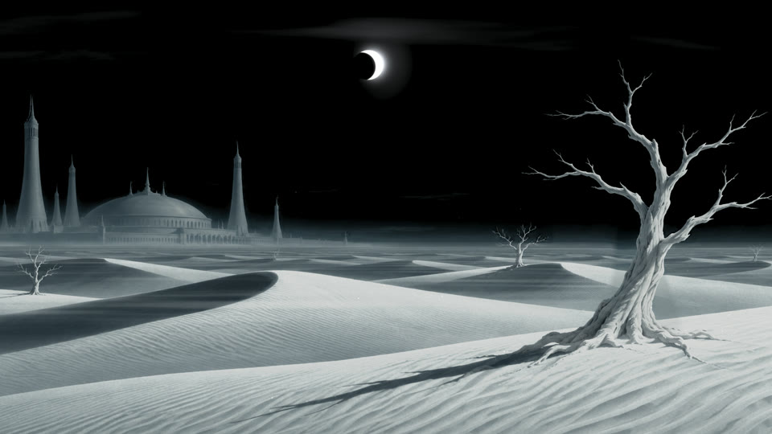
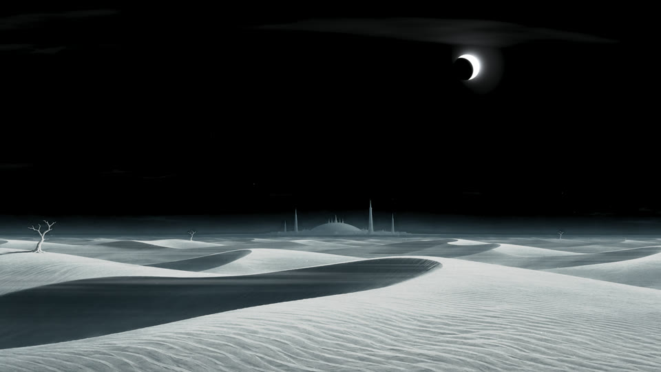

# Hollow Desert

| Lone Sentinel | Citadel Watch | Endless Night |
|---|---|---|
|  |  |  |

An animated dark-fantasy wallpaper for [Lively Wallpaper](https://www.rocksdanister.com/lively/) (Windows): an endless white desert under a starless, eternal night, with a glowing crescent moon, pale dead trees and a vast domed citadel in the haze. Painted scenes brought to life with parallax depth, blowing sand, drifting clouds and haze, rising motes, and rare sky rifts, distant flashes and gusts.

It is a single self-contained HTML file: no network requests, no external libraries. Tuned on a 1440p 240 Hz QD-OLED monitor.

- **Three scenes** and **three colour grades** (Bone, Azure, Crimson), chosen in Lively's Customise panel.
- **Interaction:** the cursor lifts and swirls sand; clicking sends a ring of dust across the ground; music drives the wind and the moon's glow.
- **Settings:** moon size and glow, sand brightness, blowing sand, motes, wind, parallax depth, cursor strength, music reactivity, black level, an FPS limit (60 by default) and render quality. Lively pauses it when a fullscreen app is running.
- **OLED note:** the white sand is bright by nature (about 38–54% pure black depending on the scene). Lower *Sand brightness* or pick *Endless Night* if you care about burn-in.

## Install

1. Download `hollow-desert.zip` from the [latest release](../../releases/latest).
2. Drag the zip onto the Lively window.

Or clone this repository and drag the `hollow-desert` folder onto Lively.

## Optional: matching thumbnail

Lively shows a fixed thumbnail in its library. `tools/hollow-desert-thumb-sync/watch.ps1` swaps the thumbnail to match the scene and palette you picked. It assumes the Microsoft Store version of Lively and that the wallpaper folder is named `hollow-desert` under `Library\SaveData\wptmp`; edit the paths at the top of the script for other setups. Run it once with `-Once`, or register it as a logon task to keep it running.

## Credits

The scenes were generated with an AI image model and then animated in WebGL. Everything else is original code.

## License

[MIT](LICENSE)